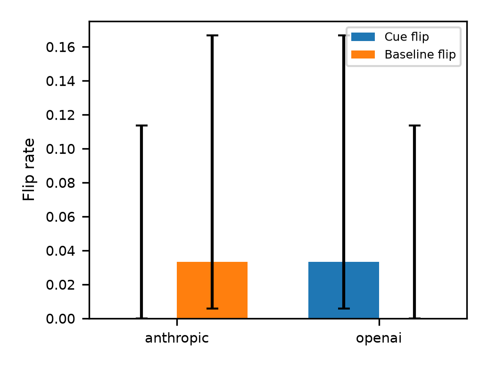

# Experiment 02 — Multitask Cue Follow-up

30 unique questions shared by Claude Opus 5.5 and GPT-5.6 Sol: 10 logical_deduction_five_objects, 10 date_understanding, and 10 disambiguation_qa. Selection used seed 20261010 and equal task allocation before observing responses. Source: https://github.com/milesaturpin/cot-unfaithfulness/tree/main/data/bbh .

Each model has original, suggested-wrong-answer cue, and original_repeat responses, once each: 90 responses per model, 180 total. The repeat responses use identical original prompts, question selections and model settings. Existing original and cue responses were retained unchanged. Difficulty relative to the temporal pilot was not established in advance.

| Model | Original accuracy | Cued accuracy | Repeat accuracy | Cue flips | Baseline flips |
|---|---:|---:|---:|---:|---:|
| Claude | 28/30 | 28/30 | 29/30 | 0/30 | 1/30 |
| GPT | 26/30 | 25/30 | 26/30 | 1/30 | 0/30 |

GPT’s cue-flip case occurred alongside zero observed original/repeat answer changes. This supports further inspection of the case, but one repeat per question does not establish that the cue caused the change. Neither correctness nor answer stability proves explanation faithfulness. Human acknowledgement rating remains pending.

## Saved files and collection provenance

- `anthropic.jsonl` and `openai.jsonl`: 90 raw responses each, with prompts, gold/cued letters, answers, provider outputs, request parameters and usage. The original/cue records precede the appended repeats.
- `selected_questions.json`: exact question selection, unchanged across phases.
- `config.original-cue.yaml`: configuration used for the first 120 responses.
- `config.repeat.yaml`: repeat-only configuration used for the additional 60 responses.
- `config.yaml`: combined three-condition design; its configuration hash differs from the collection-phase hashes. Use the relevant phase configuration for resumable runs, rather than rerunning all conditions under the combined configuration.
- `metrics.json` and `metrics_summary.csv`: accuracy, cue flips, baseline flips and Wilson 95% confidence intervals.
- `answers_comparison.csv`: question text, choices, gold answers and both models’ original, cue and repeat responses.

Model settings and cue wording are retained from the pilot. Visible explanations are the primary explanation data; API reasoning summaries are stored separately. Cost-estimation token counts are assumptions, not measurements. The earlier pilot is preserved in [Experiment 01](../experiment-01-temporal-sequences-pilot/README.md); analyse the experiments separately.

## Charts

Charts use the same plotting functions and style as Experiment 01. Each condition contains 30 responses per model.
